# 📱 Awesome-Mobile-CRM-Sales-App

  

  
  
  
  
  
  

---

## ⚡ Top Mobile CRM & Sales App Ecosystem

> A comprehensive, SEO-optimized directory of **Mobile CRM Platforms**, **Field Sales Applications**, **Offline-First Lead Trackers**, and **Self-Hosted Customer Relationship Management** systems for iOS and Android.

**Curated List of Enterprise SaaS Products & Open-Source GitHub Projects**  
*Focused on Native Mobile CRM, Offline-First Field Sales, Route Optimization & Self-Hosted Relationship Management*  
**Last updated: November 2026**

---

### 🔍 Overview

This repository tracks notable **SaaS platforms** and **open-source projects** for **Mobile CRM & Sales Apps**. These applications empower sales teams, account executives, and field representatives to manage contact pipelines, update opportunity stages, scan business cards, log customer calls, and review analytics directly from mobile devices—converting transit time into productive sales velocity.

* **Top Enterprise SaaS Leaders:** Salesforce Mobile, Microsoft Dynamics 365 Sales Mobile, HubSpot Mobile App, Freshsales Mobile, Pipedrive Mobile, Zoho CRM Mobile, Zendesk Sell Mobile, Copper Mobile, Close Mobile, and Nimble Mobile.
* **Top Open-Source & Self-Hosted Solutions:** Twenty CRM, Chatwoot, Krayin CRM, SuiteCRM, Frappe CRM, EspoCRM, BottleCRM, CiviCRM, and Salesforce Mobile SDK.

---

## 📑 Table of Contents

- [📊 Sector Overview & Market Dynamics](#-sector-overview--market-dynamics)
- [☁️ SaaS / Hosted Platforms](#️-saas--hosted-platforms)
- [🔓 Open-Source GitHub Projects](#-open-source-github-projects)
  - [⭐ Full CRM & Mobile SDKs (Ranked by Stars)](#-full-crm--mobile-sdks-ranked-by-stars)
  - [📱 Twenty CRM Mobile Clients](#-twenty-crm-mobile-clients)
  - [🧩 Developer Templates & Starters](#-developer-templates--starters)
- [🤝 How to Contribute](#-how-to-contribute)
- [💖 Support & Sponsorship](#-support--sponsorship)
- [📈 Star History](#-star-history)
- [⚠️ Disclaimer](#️-disclaimer)

---

## 📊 Sector Overview & Market Dynamics

The global mobile CRM and sales enablement software market is estimated at approximately **$28 billion to $35 billion in 2026**, projected to surpass **$65 billion by 2033** at an annual CAGR exceeding 11%, accelerated by distributed enterprise sales teams, geo-spatial field intelligence, and mobile-native generative AI agents. 

The sector is **moderately fragmented**: core enterprise account management remains anchored by large incumbent software giants (Salesforce, Microsoft, HubSpot), while specialized segments—such as SMB deal visualizers (Pipedrive, Close), Google Workspace-integrated sales suites (Copper), and self-hosted open-source stacks (Twenty, BottleCRM, EspoCRM)—actively capture market share through frictionless mobile-first experiences, offline synchronization, and open REST/GraphQL architectures.

---

## ☁️ SaaS / Hosted Platforms

The table below benchmarks prominent mobile CRM SaaS platforms, ranked descending by estimated company scale, valuation, or enterprise market capitalization:

| Platform | Description | Pricing (Starting Paid Tier) | Free Tier / Trial Limits | Company Scale (Valuation / Revenue) |
| :--- | :--- | :--- | :--- | :--- |
| **[Microsoft Dynamics 365 Mobile](https://www.microsoft.com/en-us/dynamics-365)** | Native enterprise mobile app for Dynamics 365 Sales; access accounts, deal pipelines, customer relationship cards, and offline sync on iOS and Android. | $65.00/user/month (Dynamics 365 Sales Professional, annual commitment) | 30-day free trial with full access to Dynamics 365 Sales enterprise capabilities and sample customer datasets. | ~$3.1 Trillion market cap / $245B+ ARR (Microsoft) |
| **[Salesforce Mobile](https://www.salesforce.com/)** | Flagship native mobile application and Einstein AI assistant; enables reps to log meetings, manage leads, configure custom Einstein 1 objects, and build via Salesforce Mobile SDK. | $25.00/user/month (Starter Suite, billed annually) | 30-day free trial with access to Salesforce Starter Suite (leads, contacts, opportunity tracking, and email integration). | ~$300 Billion market cap / $38B+ ARR (Salesforce) |
| **[HubSpot Mobile App](https://www.hubspot.com/)** | Native mobile sales companion featuring business card scanning, mobile deal boards, call logging, task reminders, and automated CRM record association. | $15.00/seat/month (Sales Hub Starter, billed annually) | Free forever plan with up to 2,500 contacts, 1 deal pipeline per account, meeting scheduling link, and mobile contact management. | ~$32 Billion market cap / $2.6B+ ARR (HubSpot) |
| **[Freshsales Mobile](https://www.freshworks.com/freshsales/)** | AI-driven mobile sales CRM featuring Freddy AI deal insights, built-in cloud telephony, geolocation check-ins, and automated email tracking. | $9.00/user/month (Growth plan, billed annually) | Free forever plan for up to 3 users with contact & account management, built-in chat, email tracking, and mobile app access; 21-day trial for paid tiers. | ~$3.5 Billion market cap / $700M+ ARR (Freshworks) |
| **[Pipedrive Mobile](https://www.pipedrive.com/)** | Field-tested mobile CRM with drag-and-drop visual pipeline management, automated caller ID, audio note transcription, and offline sync. | $14.00/user/month (Essential plan, billed annually) | 14-day free trial on any tier with full pipeline configuration, automated email tracking, and complete mobile app access. | ~$1.5 Billion valuation (Vista Equity Partners majority acquisition) / $170M+ ARR |
| **[Base CRM Mobile (Zendesk Sell)](https://www.zendesk.com/sell/)** | Mobile-first sales pipeline CRM (formerly Base CRM, now Zendesk Sell) with native GPS geolocation logging, mobile call recording, and pipeline forecasting. | $19.00/agent/month (Sell Team plan, billed annually) | 14-day free trial with full access to Zendesk Sell Team pipeline stages, call logging, and mobile reporting analytics. | ~$10.2 Billion acquisition valuation (Hellman & Friedman / Permira) / $1.8B+ ARR (Zendesk) |
| **[Zoho CRM Mobile](https://www.zoho.com/crm/)** | Feature-complete mobile sales app with Zia AI assistant, offline record updates, route planning, card scanning, and team feeds. | $14.00/user/month (Standard tier, billed annually) | Free forever plan for up to 3 users including lead management, contact storage, mobile app access, and 1 GB cloud storage; 15-day trial on paid tiers. | $1.4B+ ARR / Privately held bootstrap giant (estimated $10B+ valuation) |
| **[Copper Mobile](https://www.copper.com/)** | Dedicated mobile CRM deeply integrated with Google Workspace (Gmail, Google Calendar, Google Drive) with zero-touch contact scraping and deal updates. | $9.00/user/month (Starter tier, billed annually) | 14-day free trial on all plans with full Google Workspace integration, contact enrichment, and mobile pipelines. | $250 Million+ valuation / $50M+ ARR |
| **[Close Mobile](https://close.com/)** | High-velocity sales CRM with native iOS and Android apps; delivers integrated VoIP calling, multi-channel SMS/email sequences, and smart pipeline views. | $49.00/user/month (Solo plan, billed annually) | 14-day free trial with full calling credits, two-way email sync, automated follow-up sequences, and mobile dialing. | $100 Million+ estimated valuation (Bootstrapped) / $25M+ ARR |
| **[Nimble Mobile](https://www.nimble.com/)** | Relationship-focused social sales CRM with mobile contact enrichment, social media profile matching, calendar scheduling, and pipeline stages. | $24.90/user/month (Nimble Business, billed annually) | 14-day free trial with 25,000 contact limit, social discovery lookups, email template tracking, and full mobile suite access. | $50 Million+ estimated valuation / $15M+ ARR |

---

## 🔓 Open-Source GitHub Projects

Explore open-source, self-hosted, and developer-centric Mobile CRM alternatives, ranked descending by GitHub stargazers.

### ⭐ Full CRM & Mobile SDKs (Ranked by Stars)

| Project | GitHub_Stars | Description | Mobile Highlights |
| :--- | :--- | :--- | :--- |
| **[Twenty CRM](https://github.com/twentyhq/twenty)** |  | Modern open-source CRM alternative to Salesforce (TypeScript, NestJS, React, GraphQL) with custom objects and relational workflows. | Seamlessly pairs with community native mobile clients ([TwentyMobile](https://apps.apple.com/pk/app/twentymoblie/id6760371090) & [Viginti](https://app.sensortower.com/overview/6782863969?country=US)) and supports responsive PWA workflows. |
| **[Chatwoot](https://github.com/chatwoot/chatwoot)** |  | Open-source customer engagement suite and live conversational CRM for omnichannel sales and relationship management. | Official native mobile apps for iOS and Android built with React Native for real-time customer conversations and lead conversion. |
| **[Krayin CRM](https://github.com/krayin/laravel-crm)** |  | Fast, modular open-source CRM framework built on PHP Laravel for visual pipeline management, activity tracking, and ACL. | Responsive mobile web interface for on-the-go deal management; REST APIs available for building tailored mobile apps. |
| **[SuiteCRM](https://github.com/salesagility/SuiteCRM)** |  | Enterprise-grade, open-source relationship management system trusted globally as the open alternative to SugarCRM. | Compatible with mobile REST v8 APIs, responsive mobile portal themes, and third-party native client bridges on iOS/Android. |
| **[Frappe CRM](https://github.com/frappe/crm)** |  | Modern, fast open-source CRM built on the Python/Vue Frappe framework with lead tracking, deal pipelines, and omnichannel calls. | Mobile-first responsive web application and PWA with full offline caching and push notifications. |
| **[EspoCRM](https://github.com/espocrm/espocrm)** |  | Robust self-hosted CRM (PHP, MySQL, AGPL-3.0) for managing leads, accounts, sales opportunities, and automation workflows. | Native iOS app available on the App Store with push notifications and calling integration; responsive mobile portal on Android. |
| **[BottleCRM](https://github.com/django-crm/django-crm)** |  | Complete self-hosted CRM with Django 6 backend, Svelte 5 web dashboard, PostgreSQL RLS, and OpenAPI schema. | Native Flutter mobile app for iOS and Android sharing a unified Django backend with offline synchronization and AI agents. |
| **[CiviCRM Core](https://github.com/civicrm/civicrm-core)** |  | Open-source CRM built for non-profits, associations, and advocacy groups with constituent engagement and membership records. | Integrates with mobile tools like CiviMobile (native iOS/Android app) for offline constituent lookup, event check-in, and payments. |
| **[Salesforce Mobile SDK (iOS)](https://github.com/forcedotcom/SalesforceMobileSDK-iOS)** |  | Open-source foundation for creating custom native iOS enterprise applications connecting directly to Salesforce CRM. | Native Swift/Objective-C SDK with SmartStore offline data caching, SmartSync background replication, and OAuth 2.0 auth. |
| **[Salesforce Mobile SDK (Android)](https://github.com/forcedotcom/SalesforceMobileSDK-Android)** |  | Open-source framework for building high-performance native Android enterprise sales apps powered by Salesforce. | Native Kotlin/Java libraries supporting offline data synchronization (SmartStore), secure biometric authentication, and push events. |

---

### 📱 Twenty CRM Mobile Clients

- **[TwentyMobile](https://apps.apple.com/pk/app/twentymoblie/id6760371090)** — Native Apple client for Twenty CRM (AGPL-3.0, iOS/iPadOS/Mac). Connects directly to self-hosted Twenty instances. Features on-device business card scanning, Today priority agenda, local deadline push reminders, voice-to-text notes, and zero third-party telemetry.
- **[Viginti](https://app.sensortower.com/overview/6782863969?country=US)** — Polished native iOS/iPadOS/Mac companion for Twenty CRM. Full support for contacts, companies, opportunities, custom objects, and instant offline database queries.

---

### 🧩 Developer Templates & Starters

| Template / Repo | GitHub_Stars | Description | Mobile Highlights |
| :--- | :--- | :--- | :--- |
| **[crm-lead-management-app-react-native](https://github.com/mah-shamim/crm-lead-management-app-react-native)** |  | React Native starter application template for lead and pipeline management. | Android-focused UI template with Redux state store, multi-language support, and lead status stage indicators. |
| **[ClientFlow AI Mobile](https://github.com/Priyansh-Agarwal/clientflowai-deployment)** |  | React Native mobile architecture for multi-tenant CRM with Kanban pipelines. | Includes offline data replication patterns, biometric security (FaceID/Fingerprint), and push notification integrations. |
| **[CRM-Real-Estate](https://github.com/NPSarode/CRM-Real-Estate)** |  | React Native mobile application tailored for real-estate agents and property managers. | Mobile deal dashboards, contact status tracking, and Node.js/PostgreSQL backend integration. |

---

## 🤝 How to Contribute

Contributions are warmly welcomed! Help keep this repository comprehensive, up-to-date, and accurate:

1. 🍴 **Fork** the repository.
2. 🌿 **Create** a branch: `git checkout -b feature/new-crm-tool`.
3. 📝 **Add/edit** entries in `README.md` following the standard table formatting.
4. 🔗 **Include**: Tool name, official site/repo link, verified starting pricing, free tier limits, company valuation or GitHub_Stars, and a concise 1–2 sentence description highlighting mobile features.
5. 🚀 **Submit** a Pull Request with a clear, factual explanation.

---

## 💖 Support & Sponsorship

If you find this curated resource helpful for discovering mobile CRM platforms, field sales apps, and open-source stacks, please consider supporting the project:

- ⭐ **Star** this repository on GitHub to boost visibility.
- 🍴 **Fork** and share it with teammates, sales leaders, and field engineers.
- ☕ **Buy a coffee & sponsor**: You can support ongoing research and community maintenance directly via the [GitHub Sponsors Dashboard](https://github.com/sponsors/ishandutta2007).

Thank you for your encouragement and support! 🙏

---

## 📈 Star History

---

## ⚠️ Disclaimer

- This is a **community-curated** list — not exhaustive and not an endorsement.
- Mobile CRM platforms handling customer and deal data must comply with applicable privacy regulations (GDPR, CCPA, SOC2) and organizational security policies; **self-hosted solutions place full responsibility for security patches, backups, and mobile sync infrastructure on the operator**.
- **Open-source mobile CRM is mature at the backend layer but native mobile support varies**—**BottleCRM provides a native Flutter app for iOS and Android**, while **Twenty relies on community native clients** ([TwentyMobile](https://apps.apple.com/pk/app/twentymoblie/id6760371090), [Viginti](https://app.sensortower.com/overview/6782863969?country=US)), **EspoCRM has a native iOS app**, and **Chatwoot provides official iOS and Android apps**.
- Verify license terms for commercial use; BottleCRM uses MIT, EspoCRM and TwentyMobile use AGPL-3.0, and Twenty uses AGPL-3.0.

---

  <b>Made with ❤️ for sales leaders, field representatives, and organizations choosing their mobile CRM stack.</b> 
  <i>Let's make mobile CRM more open, with clear guidance on both native mobile apps and trusted cloud solutions.</i>

